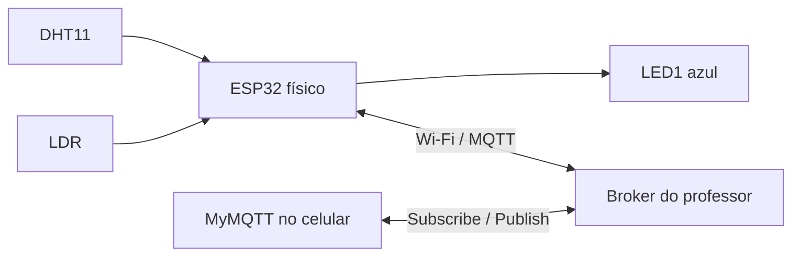

# Check-Point-05-Edge-Computing | Monitoramento com ESP32 e MQTT

**FIAP · Edge Computing · Checkpoint 05 · 22/10/2026**

## 1. Objetivo

Implementar, em **hardware físico**, a leitura de temperatura e umidade com **DHT11** e de luminosidade com **LDR**, utilizando **ESP32**. As leituras são transmitidas por Wi-Fi ao servidor MQTT disponibilizado pelo professor. O aplicativo **MyMQTT** permite **ler** as mensagens dos sensores e **escrever** comandos que acionam e desligam remotamente o LED1 azul da placa didática FIAP.

Este repositório contém o código-fonte, o mapeamento das conexões, a configuração do ambiente e o roteiro de reprodução e teste. **Não é necessário instalar um servidor próprio:** utiliza-se o broker fornecido para a atividade.

## 2. Integrantes

| Integrante | RM |
|---|---|
| Murillo Gouveia | RM571620 |
| Guilherme Mingues | RM568670 |
| Renato Munhoz | RM573570 |
| Gabriel Vianna | RM571475 |

## 3. Materiais e softwares

- ESP32 DevKit V1 / ESP32-WROOM-32D, cabo USB **com transmissão de dados** e computador Windows;
- placa didática FIAP com DHT11, sensor de luz LDR e LED1 azul;
- 5 jumpers para alimentação, sinais e LED1;
- rede Wi-Fi 2,4 GHz acessível ao ESP32 e servidor MQTT do professor;
- Arduino IDE 2.x com pacote **esp32 by Espressif Systems**;
- bibliotecas **PubSubClient** (Nick O'Leary), **DHT sensor library** e **Adafruit Unified Sensor** (Adafruit);
- aplicativo **MyMQTT** no celular.

## 4. Conexões da montagem física

A ligação foi baseada no esquema da placa didática apresentado em aula e na montagem efetivamente testada.

| ESP32 | Terminal da placa FIAP | Finalidade |
|---|---|---|
| `3V3` | `VCC` | Alimentação de 3,3 V |
| `GND` | `GND` | Referência elétrica |
| `GPIO4` (`D4`) | `DATA` | DHT11: temperatura e umidade |
| `GPIO34` (`D34`) | `LDR` | Entrada analógica de luminosidade |
| `GPIO2` (`D2`) | `LED1` | Acionamento do LED azul |

**Cuidados:** conectar os fios com a alimentação desligada; conferir as legendas da placa; **não aplicar 5 V ao GPIO34**. O circuito de semáforo (LEDs vermelho, amarelo e verde), o buzzer e o LCD **não foram ligados nem programados** nesta montagem; não são necessários para o teste de leitura/escrita MQTT aqui descrito.

### Fluxo de comunicação



## 5. Arquivos disponibilizados

```text
CP5_Vinheria_Agnello_PRONTO/
├── README.md
├── CP5_Placa_FIAP/
│   └── CP5_Placa_FIAP.ino
└── imagens/
    ├── 01-montagem-fisica.png
    └── LEIA-ME.txt
```

O arquivo `.ino` contém o **código usado com sucesso na placa física**, com os mesmos pinos, tópicos e comandos. Para não expor a rede da instituição, **a senha Wi-Fi foi substituída por um campo a preencher**; esta é a única mudança funcional em relação ao código enviado.

## 6. Como reproduzir — passo a passo

1. **Montagem:** com o ESP32 desconectado, faça as cinco conexões da seção 4, conferindo cada legenda na placa FIAP.
2. **Arduino IDE:** instale a IDE 2.x. Em **File → Preferences → Additional Boards Manager URLs**, adicione `https://espressif.github.io/arduino-esp32/package_esp32_index.json`.
3. Em **Boards Manager**, instale **esp32 by Espressif Systems**. Em **Library Manager**, instale `PubSubClient`, `DHT sensor library` e `Adafruit Unified Sensor`.
4. Abra `CP5_Placa_FIAP/CP5_Placa_FIAP.ino` na IDE. Substitua `COLOQUE_A_SENHA_WIFI_AQUI` pela senha da rede `FIAP-IOT` no campo `PASSWORD` (ou substitua SSID/senha pelos da rede de teste).
5. Confirme os parâmetros: broker `3.135.234.101`, porta `1883`, DHT11 no GPIO4, LDR no GPIO34 e LED1 no GPIO2.
6. Conecte o ESP32 ao computador por USB. Selecione **DOIT ESP32 DEVKIT V1** (ou a placa compatível) e a porta **COM** detectada.
7. Clique em **Verify** e depois em **Upload**. Se a gravação ficar parada em `Connecting...`, mantenha o botão **BOOT** pressionado até iniciar `Writing at...`, soltando-o em seguida.
8. Aguarde `100%`, `Hash of data verified` e `Hard resetting via RTS pin...`.
9. Abra **Tools → Serial Monitor**, selecione **115200 baud** e, se necessário, pressione uma vez **EN/RESET**.
10. Confirme as leituras de temperatura, umidade, luminosidade e LDR bruto, atualizadas aproximadamente a cada **5 segundos**. Verifique também a conexão Wi-Fi/MQTT.
11. Configure o **MyMQTT** conforme a seção 7 e execute os testes de recebimento, acionamento e desligamento do LED.

## 7. Configuração MQTT e testes no MyMQTT

| Configuração | Valor |
|---|---|
| Host / broker | `3.135.234.101` |
| Porta TCP | `1883` |
| Usuário / senha MQTT | Em branco, conforme teste realizado |
| Prefixo | `/TEF` |
| Identificador do dispositivo | `vinheria-mgrg` |
| Intervalo de publicação | `5000 ms` |

### 7.1 Leitura: receber os dados

No MyMQTT, conecte-se ao broker e assine (**Subscribe**) o tópico:

```text
/TEF/vinheria-mgrg/attrs/#
```

O ESP32 publica uma mensagem agrupada em `/TEF/vinheria-mgrg/attrs`, no formato:

```text
t|26.2|h|55.0|l|83|ts|1970-01-01T00:00:00Z
```

Os números acima são **um exemplo baseado nas leituras observadas**; as mensagens variam com o ambiente. O código também publica separadamente:

| Tópico | Conteúdo |
|---|---|
| `/TEF/vinheria-mgrg/attrs/t` | Temperatura em °C |
| `/TEF/vinheria-mgrg/attrs/h` | Umidade relativa em % |
| `/TEF/vinheria-mgrg/attrs/l` | Luminosidade em escala aproximada de 0 a 100 |

A luminosidade é uma conversão linear da leitura analógica (`0–4095`), **não uma medição calibrada em lux**. O sentido da escala depende do circuito LDR.

### 7.2 Escrita: ligar e desligar o LED1

No MyMQTT, abra **Publish** e informe sempre o tópico:

```text
/TEF/vinheria-mgrg/cmd
```

Para **ligar** o LED azul, publique a mensagem (incluindo `|` no final):

```text
vinheria-mgrg@on|
```

Para **desligar**, publique:

```text
vinheria-mgrg@off|
```

Para acompanhar a confirmação, assine:

```text
/TEF/vinheria-mgrg/cmdexe
```

Respostas previstas pelo código: `vinheria-mgrg@on|LED ligado` e `vinheria-mgrg@off|LED desligado`.

## 8. Resultados observados no hardware físico

Os seguintes testes foram realizados durante a execução presencial:

| Teste | Resultado |
|---|---|
| Compilação na Arduino IDE | Concluída |
| Gravação no ESP32 | Concluída e verificada (`Hash of data verified`) |
| Leitura do DHT11 | Temperatura **26,2 °C** e umidade **55%** exibidas no Monitor Serial |
| Leitura do LDR | Valor bruto **3405** e luminosidade **83%** exibidos no Monitor Serial |
| Recebimento pelo MyMQTT | Mensagens MQTT recebidas |
| Comando `@on|` | LED1 azul acendeu |
| Comando `@off|` | LED1 azul apagou |

**Observação sobre o horário:** no teste, o Monitor Serial exibiu `1970-01-01T00:00:00Z`, indicando que a sincronização NTP não foi concluída. Isso não impediu os testes de sensores e comandos MQTT, mas esse timestamp **não representa a data real da leitura**.

**Limite do escopo validado:** o recebimento MQTT no MyMQTT foi comprovado. O cadastro do dispositivo no IoT Agent, a criação de entidade NGSIv2 no Orion e o armazenamento histórico **não foram comprovados** neste teste; portanto não são apresentados como resultados alcançados.

## 9. Evidências fotográficas

A foto da montagem física já está incluída abaixo. Para as demais evidências, salvar as fotos na pasta `imagens/` e substituir as indicações pelos arquivos reais antes da entrega. Não usar fotos do Wokwi como comprovação de hardware físico.

**Foto 1 — Montagem física ESP32 + placa didática FIAP**


*Figura 1 — Montagem física do projeto Vinheria Agnello: ESP32 conectado à placa didática FIAP, com LED azul aceso.*

**Foto 2 — Arduino IDE: upload concluído**

`imagens/02-upload-concluido.jpg` — [ESPAÇO PARA FOTO COM 100% E VERIFICAÇÃO]

**Foto 3 — Monitor Serial com as leituras**

`imagens/03-monitor-serial.jpg` — [ESPAÇO PARA FOTO DAS LEITURAS DO DHT11 E LDR]

**Foto 4 — MyMQTT recebendo telemetria**

`imagens/04-mymqtt-leituras.jpg` — [ESPAÇO PARA CAPTURA DO SUBSCRIBE]

**Foto 5 — MyMQTT enviando comandos / LED1 aceso**

`imagens/05-led-ligado.jpg` — [ESPAÇO PARA CAPTURA OU FOTO DO LED ACESO]

**Foto 6 — MyMQTT enviando comando / LED1 apagado**

`imagens/06-led-desligado.jpg` — [ESPAÇO PARA CAPTURA OU FOTO DO LED APAGADO]

## 10. Simulação ilustrativa no Wokwi (atividade complementar)

Além da montagem com **ESP32 e placa didática FIAP físicos**, desenvolvemos **em casa** uma simulação no **Wokwi**, com a finalidade de **ilustrar o funcionamento e a proposta do projeto** e facilitar sua visualização.

**Acesse a simulação:** [Vinheria Agnello — Projeto no Wokwi](https://wokwi.com/projects/478585633689969665)

> **Importante:** a simulação é um material **complementar e ilustrativo**. A implementação apresentada e testada presencialmente foi feita com **componentes físicos**, conforme as fotos, o código-fonte e os testes documentados neste repositório. A simulação não substitui a demonstração prática.

## 11. Problemas comuns

| Problema | Como resolver |
|---|---|
| `Missing FQBN` | Instalar pacote ESP32 e selecionar placa no menu superior |
| `No serial data received` ao enviar | Conferir cabo/porta COM, fechar Monitor Serial, pressionar BOOT durante `Connecting...` |
| Monitor Serial mostra símbolos estranhos | Selecionar **115200 baud** |
| DHT11 não apresenta leituras | Verificar DATA no GPIO4, 3V3, GND e tipo `DHT11` |
| MyMQTT não recebe dados | Conferir IP, porta 1883, conexão Wi-Fi/MQTT e tópico exato `/TEF/vinheria-mgrg/attrs/#` |
| LED não responde | Publicar no tópico `/TEF/vinheria-mgrg/cmd` com `vinheria-mgrg@on|` ou `vinheria-mgrg@off|` |
| Data aparece como 1970 | Falha de sincronização NTP; verificar acesso a servidor de horário |

---

**Conteúdo disponibilizado:** descrição do projeto, materiais, conexões, código-fonte, instalação, reprodução, configuração MyMQTT, testes e evidência da montagem física. Os demais espaços fotográficos podem ser preenchidos com registros reais, quando disponíveis. O Wokwi é uma simulação ilustrativa feita em casa.
